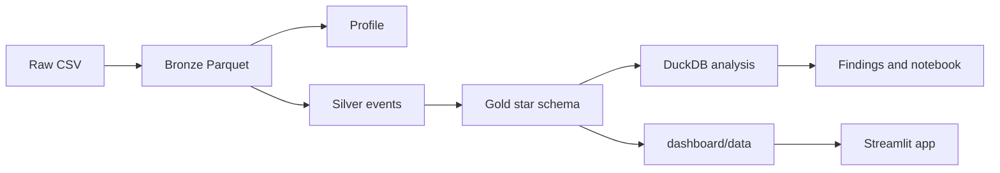

# REES46 October 2019 clickstream

The October 2019 REES46 event file records every view, cart, and purchase on one storefront, but the raw log does not say which categories, brands, or buyers produce the revenue. This project lands that file in a medallion warehouse, measures the funnel, the catalog, cart abandonment, and a one-month RFM split with definitions that stay stable from SQL to the dashboard, and publishes a small Streamlit app so those cuts can be filtered without scanning the full event table.

## Data source

The events come from **eCommerce behavior data from multi category store**, published by Michael Kechinov and collected through the [REES46](https://rees46.com) Open CDP. This repository uses the October 2019 file only.

| | |
| --- | --- |
| Dataset page | [kaggle.com/datasets/mkechinov/ecommerce-behavior-data-from-multi-category-store](https://www.kaggle.com/datasets/mkechinov/ecommerce-behavior-data-from-multi-category-store) |
| REES46 catalog | [rees46.com/en/datasets](https://rees46.com/en/datasets) |
| October 2019 file | [2019-Oct.csv.gz](https://data.rees46.com/datasets/marketplace/2019-Oct.csv.gz) |

The download link returned `content-length` 1,741,928,540 bytes on 2026-10-13. Uncompressed, `2019-Oct.csv` is 5,668,612,855 bytes. The publisher asks anyone who reuses the file to mention that dataset page and [rees46.com](https://rees46.com).

```bash
mkdir -p data/raw
curl -L -o data/raw/2019-Oct.csv.gz https://data.rees46.com/datasets/marketplace/2019-Oct.csv.gz
gunzip -f data/raw/2019-Oct.csv.gz
```

The raw file stays on disk under `data/raw/` and is left out of git. The committed dashboard extracts are aggregates of this file.

## Architecture

Bronze is the typed CSV as Parquet. Silver applies the cleaning rules. Gold is the star schema DuckDB and the dashboard both read. The app reads the extracts in `dashboard/data`.



The bronze folder is 737,707,885 bytes against a CSV of 5,668,612,855 bytes, a ratio of 7.6841×. Silver is 1,478,063,662 bytes. Gold is 1,752,720,372 bytes. The dashboard extracts from the end-to-end run are 354,128 bytes.

## Tech stack

| Piece | Choice | Role |
| --- | --- | --- |
| Python | 3.11.17 in `.venv` | Pipeline and dashboard |
| Java | OpenJDK 17.0.20.1 | Spark runtime |
| PySpark | 3.5.3 | Bronze, profile, silver, gold. Driver heap at most 12g, `local[6]` |
| DuckDB | 1.5.6 | Analysis and dashboard export, session time zone UTC |
| Parquet | zstd | Stored tables and dashboard extracts |
| Streamlit | 1.65.0 | Dashboard |
| Plotly | 7.1.0 | Notebook charts and dashboard charts |
| pandas / pyarrow | 3.0.6 / 25.0.1 | Extract reads in the app |

Root `requirements.txt` is the pipeline environment. `dashboard/requirements.txt` is the smaller set for the app.

## Data model

| Table | Grain | Rows |
| --- | --- | --- |
| `fact_events` | one cleaned event | 42,418,542 |
| `sessions` | one `user_session` | 9,244,421 |
| `dim_user` | one `user_id` | 3,022,290 |
| `dim_product` | one `product_id` | 166,794 |
| `dim_date` | one UTC date present in October | 31 |

Category lives on `dim_product` because every product has one category tuple. Brand metrics use the brand on the event: 7,701 products carry more than one brand. `sessions.user_id` is the dominant user in that session. The fact keeps the user on each event. The column list, orphan checks, and revenue definition are in [docs/data_model.md](docs/data_model.md).

## Key findings

Revenue is 229,933,212.63 from 742,773 positive-price purchases. Average order value is 309.56. 347,118 of 3,022,290 users buy.

- 337,699 of 629,560 purchase sessions have no cart event, a rate of 0.536405. The nested view, cart, and purchase path is 291,500 sessions.
- `electronics` is 176,445,577.86 of revenue, share 0.767378. `electronics / smartphone` is 157,033,913.97, share 0.682954. Apple is 111,199,495.70 at an average order value of 778.39. Samsung is 46,402,037.35 at 268.41, with a similar purchases-per-view rate.
- Event volume peaks at 16:00 UTC. Purchase count peaks at 08:00 UTC and revenue at 09:00 UTC. The highest day is 2019-10-16 at 9,747,164.72.
- 111,657 buyers with two or more purchase sessions are 32.1669% of buyers and 69.4956% of revenue. Champions are 27,453 buyers and 85,321,183.75 of revenue, shares 0.079088 and 0.371069.
- 323,267 of 628,207 session-product carts are abandoned, a rate of 0.514587. Abandoned cart value is 107,866,053.25. The higher rate is under 50. The value sits in electronics and in carts priced 1,000 and above.

The full tables and the recommendations are in [docs/key_findings.md](docs/key_findings.md). Every figure there is a cell from [docs/analysis_results.md](docs/analysis_results.md).

## Dashboard

The Streamlit app is [dashboard/app.py](dashboard/app.py). It filters the committed extracts by UTC date and category. Event type filters the heatmap. Distinct users are exact for the full month and for a single day. A shorter range shows the average of the daily distinct counts.

Live app: `https://YOUR_STREAMLIT_APP_URL`

Add these screenshots after a browser pass of the running app:

- `docs/screenshots/overview.png` for the KPI cards, event funnel, and daily revenue
- `docs/screenshots/products.png` for categories, brands, price bands, and abandonment
- `docs/screenshots/customers.png` for RFM segments and the UTC hour-by-weekday heatmap

## How to run

From the repository root, with JDK 17 on the machine:

```bash
export JAVA_HOME=$(/usr/libexec/java_home -v 17)
export PATH="$JAVA_HOME/bin:$PATH"
python3.11 -m venv .venv
source .venv/bin/activate
make all
streamlit run dashboard/app.py
```

`make all` runs the steps below in order. Download `2019-Oct.csv` with the commands in [Data source](#data-source) first. The scripts overwrite their outputs and leave the raw file unchanged.

| Target | Script | Output |
| --- | --- | --- |
| `make setup` | `src/00_check_env.py` after `pip install -r requirements.txt` | Spark and DuckDB smoke test |
| `make ingest` | `src/01_ingest_bronze.py` | `data/bronze/events` |
| `make profile` | `src/02_profile.py` | `docs/data_profile.md` |
| `make clean` | `src/03_clean_silver.py` | `data/silver/events` and `docs/cleaning_log.md` |
| `make gold` | `src/04_build_gold.py` | `data/gold/` and `docs/data_model.md` |
| `make analyze` | `src/05_run_analysis.py` | `docs/analysis_results.md` |
| `make dashboard` | `src/06_export_dashboard_data.py` | `dashboard/data/*.parquet` |

`make clean` is the silver job. The notebook reads the same SQL as the analysis runner:

```bash
jupyter nbconvert --to notebook --execute --inplace notebooks/eda.ipynb --ExecutePreprocessor.timeout=300
```

A Streamlit Cloud deploy should install `dashboard/requirements.txt` and start `dashboard/app.py`. The extracts in `dashboard/data` are the data that deploy needs.

The repository is [github.com/Oyegun22/ecommerce-clickstream-analytics](https://github.com/Oyegun22/ecommerce-clickstream-analytics).

## Future improvements

- Add months beyond October so recency and repeat purchase describe a longer history. In this file, recency only ranks days before 2019-10-31.
- Attach a store time zone before converting the UTC hour peaks into local trading hours.
- Fill `category_code` for the unknown category, which is 22,922,165.08 of revenue, and review the unknown brand, which is 8,539,747.08.
- Explain the 348 sessions that contain more than one `user_id` if the source system can separate shared devices from logging errors.
- Move the Spark jobs off one laptop when the event file no longer fits a 12g driver.
- Replace the dashboard URL and add the three screenshots above after the app is deployed.
