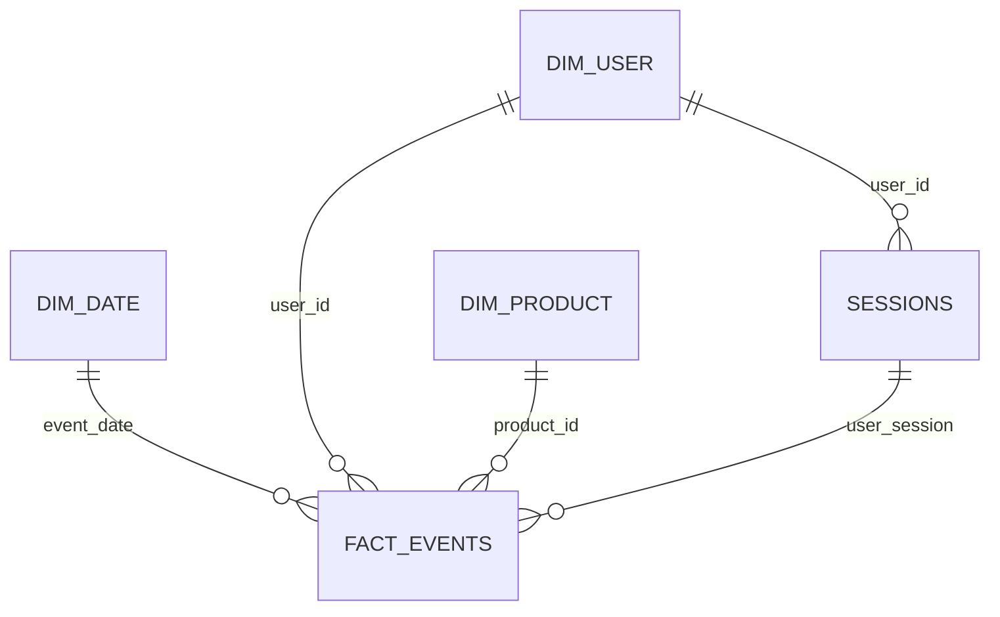

# Gold data model

Star schema built from `data/silver/events`. Run 2026-10-09 20:33:07 UTC on Spark 3.5.3. Elapsed 74.3 seconds.

Category is a property of `product_id` on this file, so it lives only on `dim_product`. Brand is not. `fact_events.brand` is the brand recorded on the event. `dim_product.brand` is the most common brand for that product, with the smaller brand string winning a tie.

`sessions` is a fact at session grain, not a dimension. It is drawn beside the dimensions because every event points at one session.

## Grains

| Table | Grain | Rows |
| --- | --- | --- |
| fact_events | one silver event | 42,418,542 |
| sessions | one user_session | 9,244,421 |
| dim_user | one user_id | 3,022,290 |
| dim_product | one product_id | 166,794 |
| dim_date | one event_date present in the month | 31 |

## fact_events

Partitioned by `event_date`. One file per day.

| Column | Role |
| --- | --- |
| event_date | Foreign key to dim_date. UTC date. |
| event_time | Event instant. UTC. |
| event_type | view, cart, or purchase. |
| user_id | Foreign key to dim_user. The user on this event. |
| user_session | Foreign key to sessions. |
| product_id | Foreign key to dim_product. |
| brand | Degenerate dimension. The brand on this event, not the modal brand. |
| price | Price recorded on the event. Zero prices are kept. |
| is_non_positive_price | True when price is not null and price <= 0. |

Null brand rows: 0.

## dim_product

| Column | Role |
| --- | --- |
| product_id | Primary key. |
| category_id, category_code, category_l1, category_l2, category_l3 | The product's only category tuple. |
| brand | Modal brand. Tie breaks to the smaller brand string. |
| brand_events | Events that carry the modal brand. |
| n_events | Events for this product. |
| n_brands | Distinct brands seen on this product. |
| has_brand_conflict | True when n_brands > 1. |

Products: 166,794. Products with more than one category tuple: 0. Products with more than one brand: 7,701, covering 1,724,111 events. Of those events, 1,612,796 carry the modal brand. Purchases on a multi-brand product: 20,096, revenue 6,400,447.26.

Use `fact_events.brand` for brand revenue. Using `dim_product.brand` would relabel the other brands on a conflicted product.

## dim_user

| Column | Role |
| --- | --- |
| user_id | Primary key. |
| first_seen | Minimum event_time. |
| last_seen | Maximum event_time. |
| total_events | Events with this user_id. |
| n_sessions | Distinct user_session values on those events. |
| n_purchases | Purchase events. Includes a purchase whose price flag is true. |

The sum of `n_sessions` is 9,244,770. `sessions` has 9,244,421 rows. The difference is user links inside sessions that contain more than one user_id.

## dim_date

The column is `event_date`, not `date`, so SQL joins do not need a reserved word. `day_of_week` is 1 for Monday through 7 for Sunday. `is_weekend` is Saturday or Sunday of that UTC date. `week` is Spark `weekofyear`. The spine has 31 dates, 2019-10-01 through 2019-10-31, of which 8 are weekend dates.

| event_date | day_of_week | day_name | is_weekend | week | year |
| --- | --- | --- | --- | --- | --- |
| 2019-10-01 | 2 | Tuesday | false | 40 | 2019 |
| 2019-10-02 | 3 | Wednesday | false | 40 | 2019 |
| 2019-10-03 | 4 | Thursday | false | 40 | 2019 |
| 2019-10-04 | 5 | Friday | false | 40 | 2019 |
| 2019-10-05 | 6 | Saturday | true | 40 | 2019 |
| 2019-10-06 | 7 | Sunday | true | 40 | 2019 |
| 2019-10-07 | 1 | Monday | false | 41 | 2019 |
| 2019-10-08 | 2 | Tuesday | false | 41 | 2019 |
| 2019-10-09 | 3 | Wednesday | false | 41 | 2019 |
| 2019-10-10 | 4 | Thursday | false | 41 | 2019 |
| 2019-10-11 | 5 | Friday | false | 41 | 2019 |
| 2019-10-12 | 6 | Saturday | true | 41 | 2019 |
| 2019-10-13 | 7 | Sunday | true | 41 | 2019 |
| 2019-10-14 | 1 | Monday | false | 42 | 2019 |
| 2019-10-15 | 2 | Tuesday | false | 42 | 2019 |
| 2019-10-16 | 3 | Wednesday | false | 42 | 2019 |
| 2019-10-17 | 4 | Thursday | false | 42 | 2019 |
| 2019-10-18 | 5 | Friday | false | 42 | 2019 |
| 2019-10-19 | 6 | Saturday | true | 42 | 2019 |
| 2019-10-20 | 7 | Sunday | true | 42 | 2019 |
| 2019-10-21 | 1 | Monday | false | 43 | 2019 |
| 2019-10-22 | 2 | Tuesday | false | 43 | 2019 |
| 2019-10-23 | 3 | Wednesday | false | 43 | 2019 |
| 2019-10-24 | 4 | Thursday | false | 43 | 2019 |
| 2019-10-25 | 5 | Friday | false | 43 | 2019 |
| 2019-10-26 | 6 | Saturday | true | 43 | 2019 |
| 2019-10-27 | 7 | Sunday | true | 43 | 2019 |
| 2019-10-28 | 1 | Monday | false | 44 | 2019 |
| 2019-10-29 | 2 | Tuesday | false | 44 | 2019 |
| 2019-10-30 | 3 | Wednesday | false | 44 | 2019 |
| 2019-10-31 | 4 | Thursday | false | 44 | 2019 |

## sessions

Not partitioned by date. A session can start on one UTC date and end on the next.

| Column | Role |
| --- | --- |
| user_session | Primary key. |
| user_id | User with the most events in the session. Smaller user_id wins a tie. Foreign key to dim_user. |
| has_user_conflict | True when the session contains more than one user_id. |
| n_users | Distinct user_id values in the session. |
| session_start, session_end | Min and max event_time. |
| duration_seconds | session_end minus session_start, in seconds. A single instant has duration 0. |
| n_events, n_views, n_carts, n_purchases | Counts of events in the whole session. |
| revenue | Sum of price on purchases with is_non_positive_price = false. Otherwise 0. |

Sessions with more than one user_id: 348. Sessions whose start and end fall on different UTC dates: 29,606. Sessions with duration 0: 3,271,152. Duration ranges from 0 to 2,640,529 seconds.

## Revenue

Revenue is not the sum of every price. It is purchase price where `is_non_positive_price` is false. Fact revenue is 229,933,212.63. The sum of `sessions.revenue` is 229,933,212.63.

## Reconciliation

| Check | Fact or users | Sessions |
| --- | --- | --- |
| Events | 42,418,542 | 42,418,542 |
| Views | 40,777,328 | 40,777,328 |
| Carts | 898,441 | 898,441 |
| Purchases | 742,773 | 742,773 |
| Revenue | 229,933,212.63 | 229,933,212.63 |
| Sum of user total_events | 42,418,542 |  |
| Sum of user n_purchases | 742,773 |  |
| User-session links | 9,244,770 | 9,244,770 |

## Orphan keys

Each value is a count of distinct keys on the left that are missing from the right. Zero means the foreign key holds.

| Check | Missing keys |
| --- | --- |
| fact_events.user_id missing from dim_user | 0 |
| fact_events.product_id missing from dim_product | 0 |
| fact_events.event_date missing from dim_date | 0 |
| fact_events.user_session missing from sessions | 0 |
| sessions.user_id missing from dim_user | 0 |
| dim_user.user_id missing from fact_events | 0 |
| dim_product.product_id missing from fact_events | 0 |
| dim_date.event_date missing from fact_events | 0 |
| sessions.user_session missing from fact_events | 0 |
| sessions.user_id not present on that session in fact_events | 0 |

## Folder size

| Path | Bytes |
| --- | --- |
| data/gold/fact_events | 1,353,311,820 |
| data/gold/sessions | 349,310,794 |
| data/gold/dim_user | 49,150,966 |
| data/gold/dim_product | 944,677 |
| data/gold/dim_date | 2,115 |
| data/gold total | 1,752,720,372 |
